# TP 3 – Activité 3-1 : Acceptation de plusieurs clients

**Faculté des Sciences de Sfax** – Département d'informatique et des Communications  
**Matière :** Développement d'applications réparties – **Auditoire :** LSI 3 1 tp1 – **Année universitaire :** 2026 – 2027  
**Réalisé par : Nour Hbaieb

---

## 1. Objectif

Les applications Client/Serveur des TP1 et TP2 ne géraient qu'un seul client par exécution du serveur.
Cette activité les transforme en un **serveur multi-threads** basé sur les sockets TCP en Java, capable de traiter **plusieurs clients simultanément**.

## 2. Environnement

- JDK 25, IntelliJ IDEA (machine Windows : serveur et clients Java)
- Machine virtuelle Ubuntu sous VirtualBox (client distant, test en réseau)
- Telnet (client de test), Git / GitHub

## 3. Structure du projet

```
TP3-DAR2026/
├── src/
│   ├── Main.java                # fichier généré par IntelliJ (non utilisé)
│   ├── serverPackage/
│   │   ├── Server.java          # accepte les connexions, numérote les clients
│   │   └── ClientHandler.java   # thread dédié à un client (calculatrice)
│   └── clientPackage/
│       └── Client.java          # client Java (calculatrice)
├── images/                      # captures d'écran du README
└── README.md
```

## 4. Principe de fonctionnement

| Classe | Rôle |
|---|---|
| `Server` | Ouvre un `ServerSocket` sur le port **1234** (toutes les interfaces). Une boucle infinie appelle `accept()`. À chaque connexion, il incrémente un compteur `AtomicInteger` (numéro d'ordre), affiche l'adresse du client avec `getRemoteSocketAddress()`, puis crée un `ClientHandler` et revient aussitôt à `accept()`. |
| `ClientHandler` | Hérite de `Thread`. Envoie au client son numéro d'ordre (`writeUTF`), puis traite ses opérations (`+ - * /`) jusqu'à ce qu'il quitte. Chaque client a son propre thread. |
| `Client` | Se connecte au serveur (IP passée en argument ou valeur par défaut) avec `InetAddress` et `InetSocketAddress`, affiche le numéro reçu, puis envoie les opérations saisies et affiche les résultats. |

**Protocole (binaire)** : `boolean` (true = opération, false = quitter), `int` (opérande 1), `UTF` (opérateur), `int` (opérande 2). Le serveur répond par une chaîne `UTF`.

**Pourquoi le serveur gère plusieurs clients :** dans le TP2, le serveur traitait son unique client dans le thread principal, donc `accept()` n'était appelé qu'une seule fois. Ici, le thread principal ne fait qu'accepter les connexions et délègue chaque client à un thread séparé : un client lent ou inactif ne bloque pas les autres.

## 5. Exécution

**Dans IntelliJ (machine Windows) :**

1. Lancer `Server` (il affiche *« En attente de clients... »*).
2. Lancer plusieurs fois `Client` (option *Allow multiple instances* activée dans la configuration d'exécution).

**Depuis un terminal (par exemple sous Ubuntu), à la racine du projet :**

```bash
javac -encoding UTF-8 -d bin src/clientPackage/Client.java
java -cp bin clientPackage.Client <IP_du_serveur>
```

Sans argument, le client se connecte à `localhost`.

---

## 6. Tests

### 6.1 Test local : plusieurs clients Java

Le serveur est lancé, puis deux instances de `Client` sont exécutées sur la même machine (`localhost`).

**Client n°1** : il reçoit son numéro d'ordre.

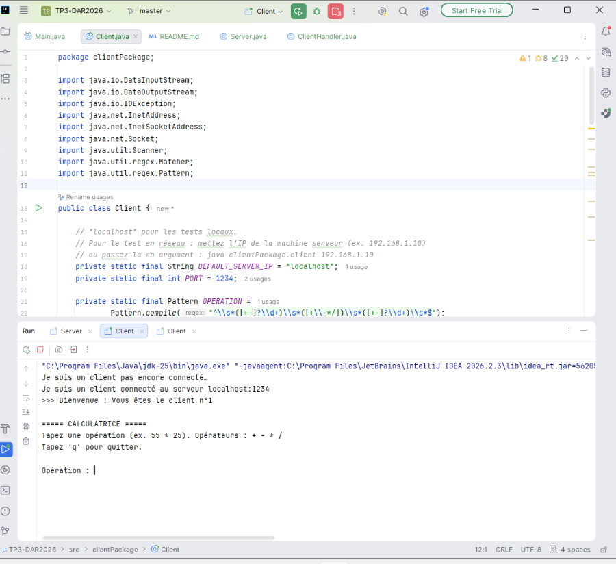

**Client n°2** : une deuxième instance se connecte pendant que la première est toujours active.

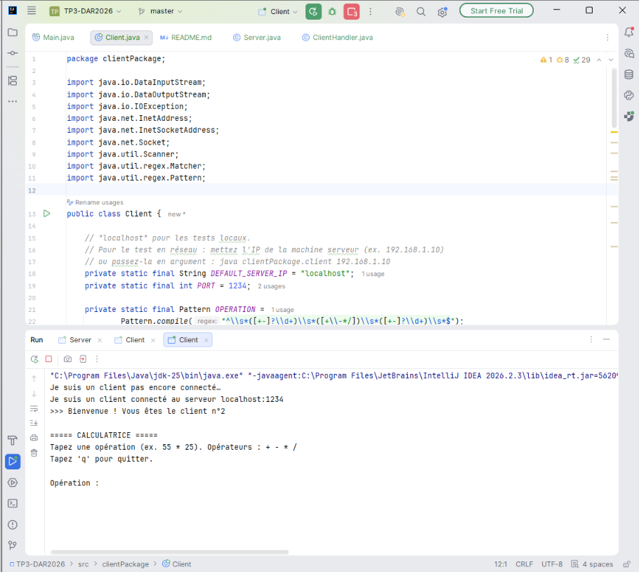

**Console du serveur** : les deux clients sont connectés en même temps. Le serveur affiche pour chacun son numéro d'ordre et son adresse (`/127.0.0.1:56207` et `/127.0.0.1:56211`). Chaque client est géré par son propre thread (`[Client n°1]` et `[Client n°2]` attendent chacun une opération).

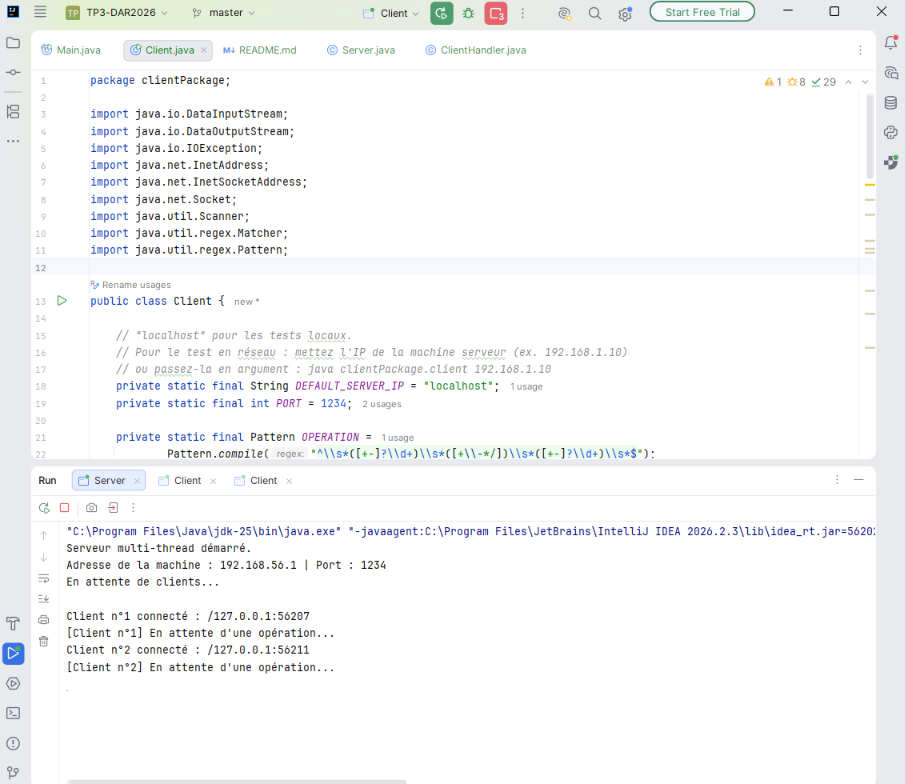

### 6.2 Test local : client Telnet

Commande utilisée : `telnet localhost 1234`

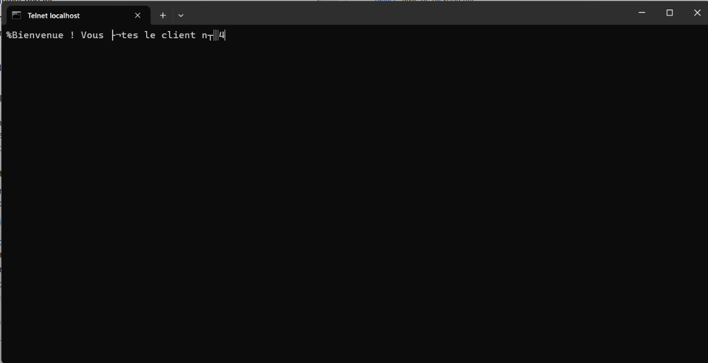

Le serveur accepte la connexion Telnet comme celle d'un client Java et lui attribue un numéro d'ordre (ici le n°4). Le message de bienvenue s'affiche, mais avec des caractères parasites :

- Le caractère `%` au début correspond au **préfixe de longueur de 2 octets** que `writeUTF()` ajoute devant la chaîne (ici 37 octets, soit le code ASCII 37 = `%`).
- Les caractères `├¬` et `┬░` à la place de `ê` et `°` viennent de l'**encodage** : le serveur envoie de l'UTF-8, alors que la console Windows affiche en page de code OEM.

Telnet ne permet pas d'effectuer des calculs, car notre protocole est **binaire** (`readBoolean`, `readInt`...) et non textuel. Ce test valide donc la connexion simultanée et la numérotation.

### 6.3 Test en réseau local (serveur Windows, client Ubuntu)

- **Serveur** : PC Windows, adresse `192.168.1.7`, port 1234 ouvert dans le pare-feu.
- **Client** : machine virtuelle Ubuntu, avec le client compilé (`javac`) et lancé avec l'IP du serveur :

```bash
javac -encoding UTF-8 -d bin src/clientPackage/Client.java
java -cp bin clientPackage.Client 192.168.1.7
```

**Connexion du client distant** : le client se connecte à `192.168.1.7:1234` et reçoit son numéro d'ordre.

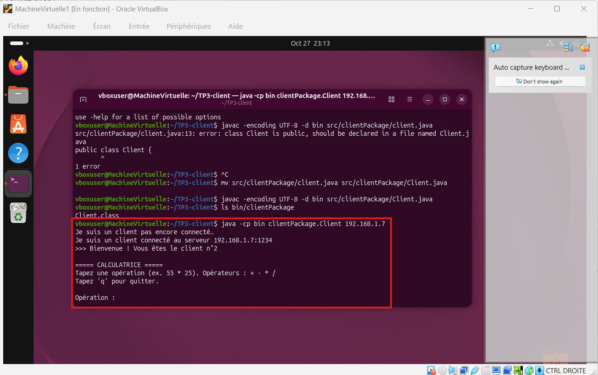

**Utilisation de la calculatrice depuis la machine distante** : `55 * 25 = 1375`, `10 / 4 = 2.5`, la division par zéro est correctement refusée, puis `q` ferme la session.

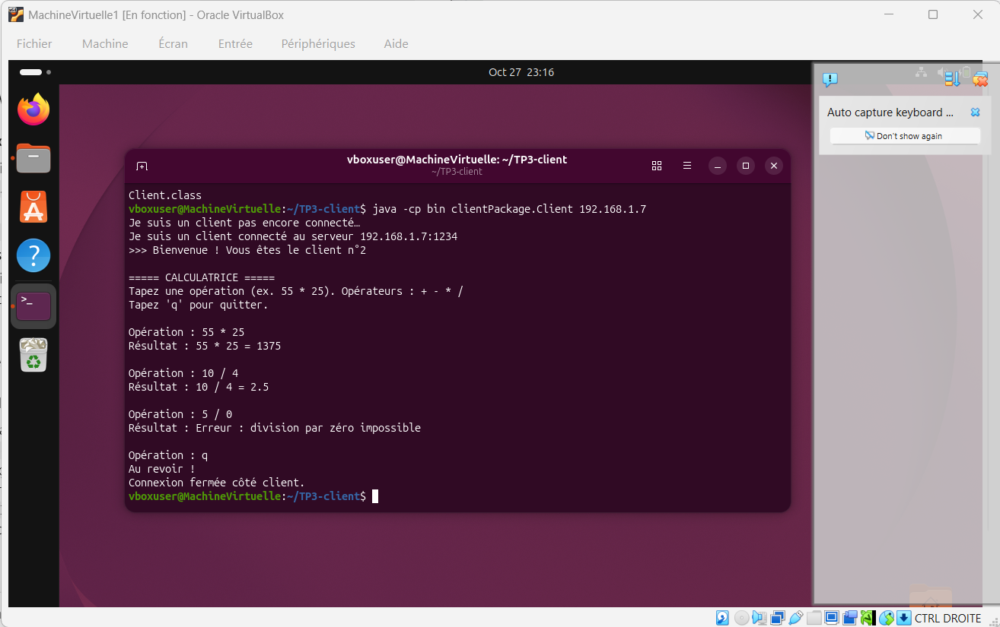

**Console du serveur pendant le test en réseau** : le serveur affiche la connexion du client distant (`Client n°2 connecté : /192.168.1.7:60398`), puis chaque opération reçue et le résultat renvoyé. Ces opérations (`55 * 25`, `10 / 4`, `5 / 0`) sont celles saisies depuis la machine virtuelle Ubuntu, et la déconnexion est détectée à la fin (`Client n°2 déconnecté.`).

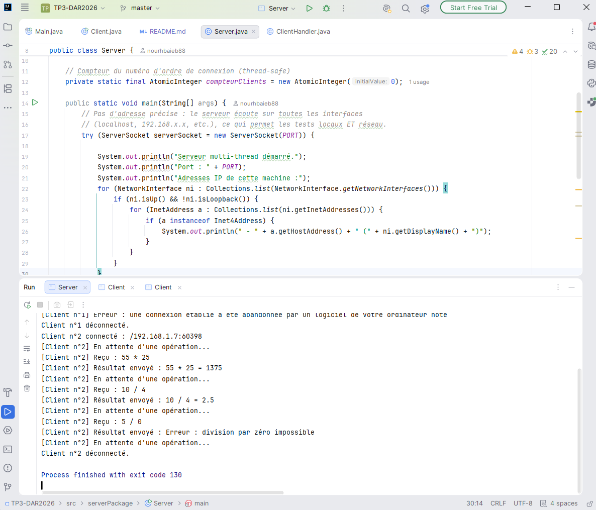

> **Remarque :** l'adresse affichée (`192.168.1.7`) est celle de la machine Windows hôte, car la VM est en mode réseau NAT de VirtualBox : l'hôte voit la connexion comme venant de sa propre adresse. Le client Ubuntu reste un processus distinct, tournant dans la VM, qui se connecte à l'adresse du réseau local et non à `localhost`.

---

## 7. Synthèse

- Le serveur multi-threads répond à l'objectif : la boucle `accept()` tourne en continu et **un thread `ClientHandler` est créé par client**, ce qui permet de servir plusieurs clients simultanément (clients Java, Telnet, machine distante).
- Chaque client reçoit son **numéro d'ordre** de connexion, calculé avec un `AtomicInteger` (thread-safe), et le serveur affiche son adresse IP avec `getRemoteSocketAddress()`.
- Le serveur écoute avec `new ServerSocket(PORT)` sur **toutes les interfaces**. Ainsi, `localhost` et l'adresse du réseau local fonctionnent avec le même code. Dans le TP2, l'adresse fixe `192.168.56.1` (carte VirtualBox) empêchait de tester avec `localhost`.
- Le client reçoit l'IP du serveur en argument (classes `InetAddress` et `InetSocketAddress`), ce qui permet de le tester sur n'importe quelle machine du réseau.
- Si un client se déconnecte brutalement, seul son thread s'arrête : le serveur et les autres clients ne sont pas affectés.

**Difficultés rencontrées et solutions**

| Problème | Solution |
|---|---|
| `telnet` non reconnu | Activation du *Client Telnet* dans les fonctionnalités Windows (`dism /online /Enable-Feature /FeatureName:TelnetClient`) |
| Client distant impossible à joindre | Ouverture du port 1234 dans le pare-feu Windows (`New-NetFirewallRule ...`) et utilisation de l'IP du réseau local (`192.168.1.7`) et non celle de VirtualBox (`192.168.56.1`) |
| `Could not find or load main class` sur Ubuntu | Mauvais dossier de travail et structure de packages : compilation avec `javac -d bin` depuis la racine du projet |
| `class Client is public, should be declared in a file named Client.java` | Linux est sensible à la casse : le fichier doit porter exactement le nom de la classe (`Client.java`) |
| Caractères parasites dans Telnet | Préfixe de longueur de `writeUTF` et encodage UTF-8 / console Windows (voir 6.2) |

**Remarque sur la numérotation** : les captures proviennent de plusieurs sessions d'exécution. Le compteur repart à 1 à chaque redémarrage du serveur, d'où des numéros différents d'une capture à l'autre (par exemple « client n°2 » dans les tests locaux et sur la machine Ubuntu, « client n°4 » pour Telnet).


---

# Activité 3-2 : Amélioration de l'application calculatrice

## 1. Objectif

Reprendre le service de calculatrice et l'intégrer au serveur multi-threads de l'activité 3-1, avec :

- une **communication client/serveur par objets** (`ObjectInputStream` / `ObjectOutputStream`) ;
- un **compteur global** du nombre d'opérations traitées par le serveur, **partagé entre tous les threads** `ClientProcess` et protégé par synchronisation (accès concurrent).

L'activité 3-2 est dans des packages séparés (`activite32.*`) pour ne pas modifier le code de l'activité 3-1. Les deux serveurs utilisent le port 1234 : il faut arrêter l'un avant de lancer l'autre.

## 2. Structure du code

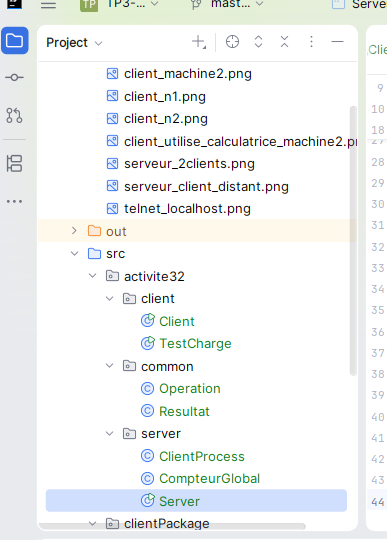

| Classe | Rôle |
|---|---|
| `Operation` (`common`) | Objet `Serializable` envoyé par le client : opérande 1, opérateur, opérande 2, et un indicateur de fin de session. |
| `Resultat` (`common`) | Objet `Serializable` renvoyé par le serveur : message, indicateur d'erreur et numéro d'opération (valeur du compteur global). |
| `Server` | Accepte les connexions dans une boucle infinie, numérote les clients (`AtomicInteger`) et crée un `ClientProcess` par client. |
| `ClientProcess` | Thread dédié à un client. Lit des objets `Operation`, calcule, incrémente le compteur global et renvoie un objet `Resultat`. |
| `CompteurGlobal` | Ressource critique : compteur statique dont l'incrémentation et l'affichage sont protégés par un bloc `synchronized`. |
| `Client` | Envoie des objets `Operation` et affiche les objets `Resultat` reçus. |
| `TestCharge` | Lance 5 clients en parallèle de 20 opérations chacun (100 opérations au total) pour vérifier la cohérence du compteur. |

### Communication par objets

- Les classes `Operation` et `Resultat` implémentent `Serializable`, car les objets sont transformés en octets pour traverser le réseau.
- Ces deux classes sont dans le package `common`, partagé par le client et le serveur : les deux côtés doivent avoir exactement la même classe.
- Côté serveur et côté client, on crée d'abord l'`ObjectOutputStream` et on appelle `flush()`, puis on crée l'`ObjectInputStream`. Le constructeur d'`ObjectInputStream` lit un en-tête envoyé par l'autre côté. Si les deux côtés créaient leur `ObjectInputStream` en premier, ils s'attendraient mutuellement et le programme resterait bloqué.

### Gestion de l'accès concurrent

```java
public static int incrementerEtAfficher(int numeroClient, String operation) {
    synchronized (VERROU) {
        valeur++;
        System.out.println("[Compteur global] = " + valeur + "  (client n°" + numeroClient + " : " + operation + ")");
        return valeur;
    }
}
```

`valeur++` n'est pas une opération atomique : elle se décompose en lecture, addition et écriture. Sans `synchronized`, deux threads pourraient lire la même valeur et écrire le même résultat, ce qui ferait perdre une incrémentation. L'incrémentation et l'affichage sont dans le même bloc synchronisé pour que les valeurs s'affichent dans l'ordre (1, 2, 3...) sans doublon.

## 3. Tests

### 3.1 Démarrage du serveur

Le serveur affiche son port et toutes les adresses IP de la machine (réseau local et carte VirtualBox).

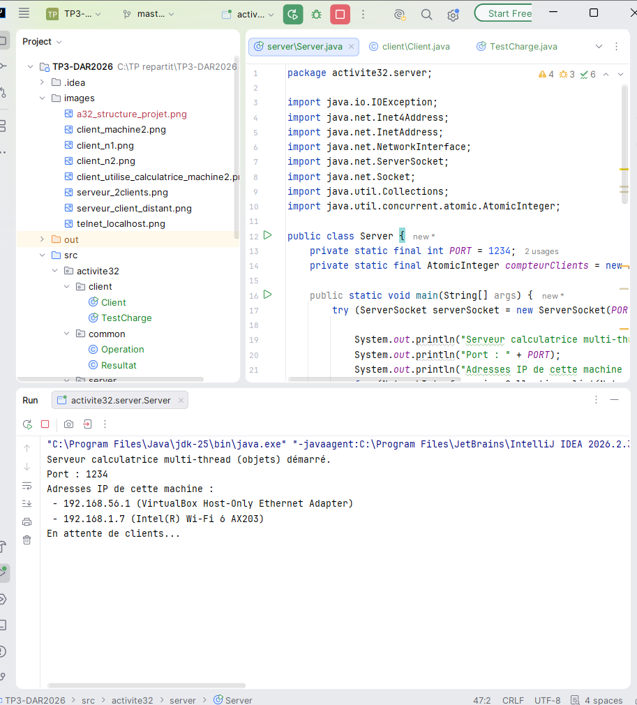

### 3.2 Test local : plusieurs clients en parallèle

Deux instances du client sont lancées sur la même machine et envoient leurs opérations en alternance.

**Client n°1**

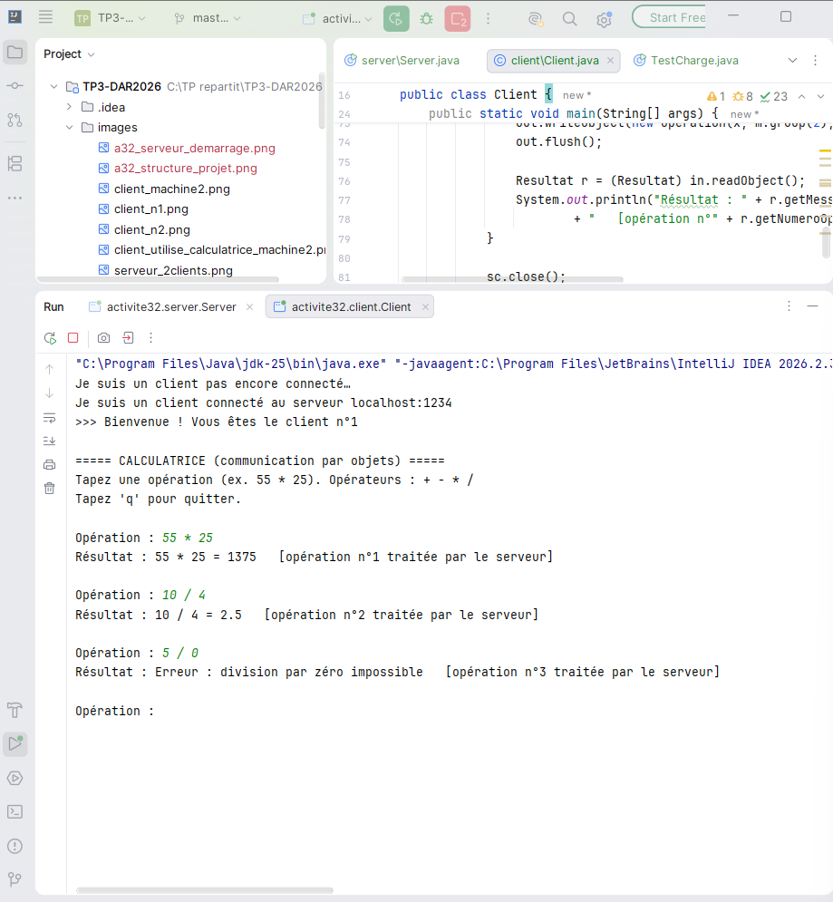

**Client n°2**

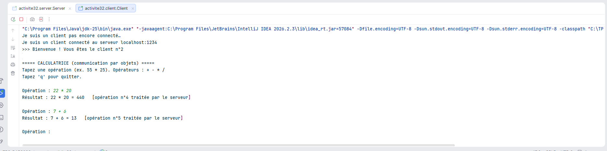

Chaque client reçoit en plus de son résultat le **numéro d'opération** donné par le compteur global. Comme le compteur est partagé, les numéros des deux clients s'alternent et ne se chevauchent pas.

**Console du serveur** : les messages des clients n°1 et n°2 sont entremêlés. Chaque client est donc traité en parallèle par son propre thread. Le compteur global augmente de 1 à chaque opération, quel que soit le client.

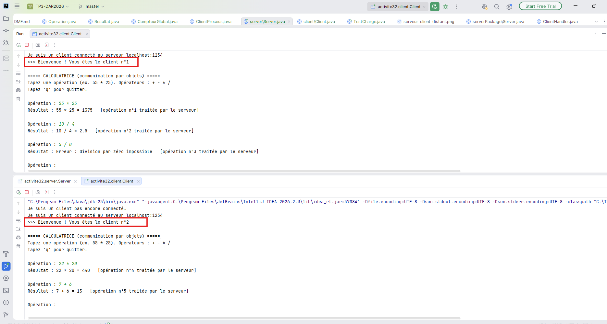

### 3.3 Test en réseau local (serveur Windows, client Ubuntu)

- **Serveur** : PC Windows, adresse `192.168.1.7`, port 1234.
- **Client** : machine virtuelle Ubuntu. Le code du client a été copié dans la VM (packages `common` et `client`), puis compilé et lancé :

```bash
javac -encoding UTF-8 -d bin src/activite32/common/*.java src/activite32/client/*.java
java -cp bin activite32.client.Client 192.168.1.7
```

**Côté client (Ubuntu)**

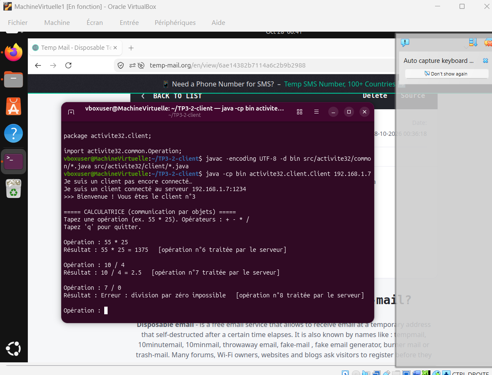

**Côté serveur (Windows)** : le client distant se connecte et le compteur global continue de s'incrémenter avec ses opérations.

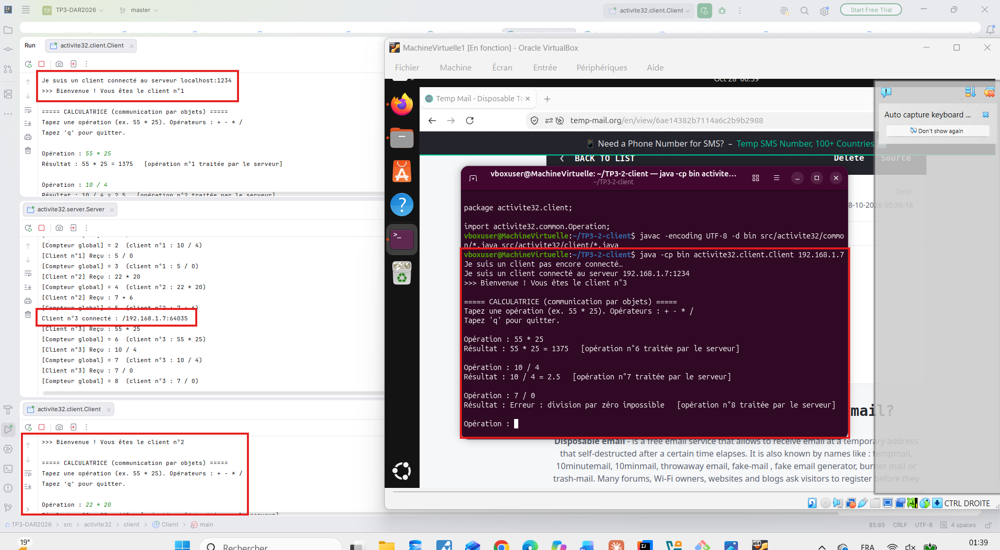

> **Remarque :** la VM utilise le mode réseau NAT de VirtualBox. Le serveur voit donc la connexion comme venant de l'adresse de l'hôte (`192.168.1.7`). Le client reste un processus distinct tournant dans la VM, qui se connecte à l'adresse du réseau local et non à `localhost`.

### 3.4 Test de charge : cohérence du compteur global

La classe `TestCharge` lance **5 clients simultanés** qui envoient chacun **20 opérations**, soit **100 opérations** attendues. Le serveur a été redémarré avant le test pour que le compteur parte de 0.

**Côté client**

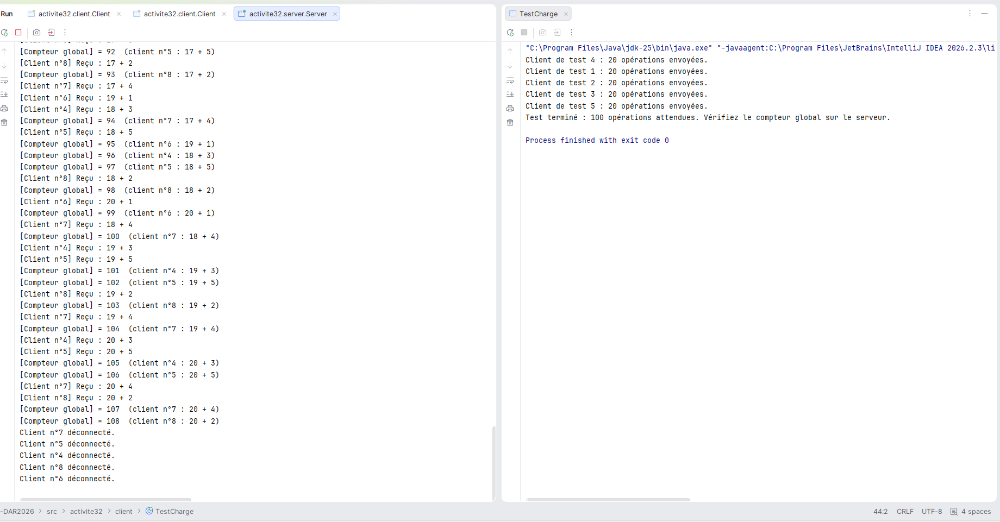

**Côté serveur** : le compteur global atteint exactement **100**, sans doublon ni valeur manquante.


## 4. Synthèse

- Le serveur crée un thread `ClientProcess` par client. Les clients sont servis en parallèle et chacun garde une communication indépendante avec le serveur.
- La communication par **objets sérialisés** remplace les lectures et écritures de types primitifs (`readInt`, `writeUTF`...) : le client envoie un objet `Operation` et reçoit un objet `Resultat`. Le protocole est plus lisible et plus facile à faire évoluer (par exemple en ajoutant un champ à `Resultat`).
- Le **compteur global** est une ressource critique partagée par tous les threads. Il est protégé par un bloc `synchronized`, qui garantit un seul accès à la fois. Le test de charge (5 clients × 20 opérations) donne bien 100, sans doublon.
- Le test en réseau local montre que le même code fonctionne entre deux systèmes différents (Windows et Ubuntu) : il suffit de passer l'IP du serveur en argument au client.

**Difficultés rencontrées et solutions**

| Problème | Solution |
|---|---|
| Deux serveurs sur le même port 1234 (3-1 et 3-2) | Arrêter le serveur de l'activité 3-1 avant de lancer `activite32.server.Server` |
| Partage du code avec la VM sans Git | Copier-coller des fichiers dans la VM avec `nano`, en créant d'abord les dossiers correspondant aux packages |
| Compilation côté Ubuntu | Inclure le package `common` dans la commande `javac`, car le client utilise `Operation` et `Resultat` |
| Blocage possible à la connexion avec les flux d'objets | Créer l'`ObjectOutputStream` et appeler `flush()` avant de créer l'`ObjectInputStream`, des deux côtés |
